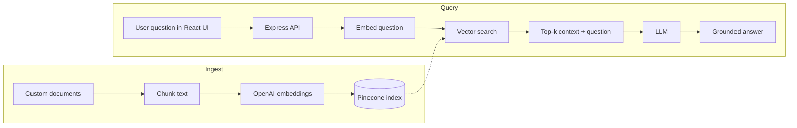
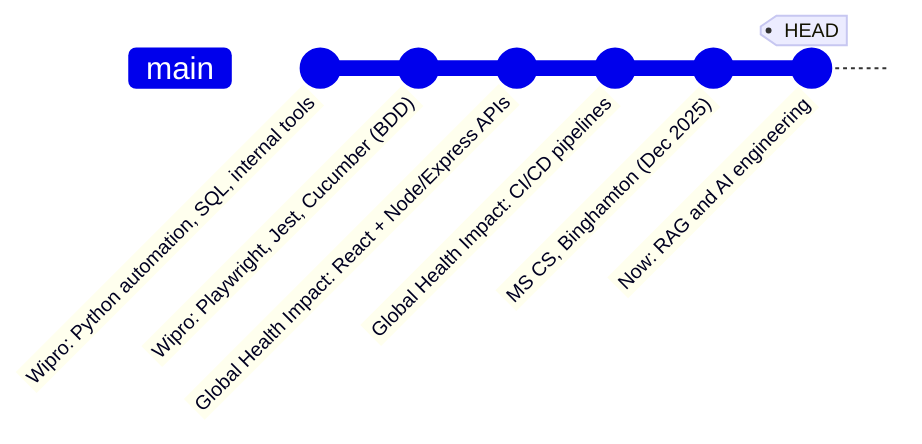

<div align="center">


[](https://linkedin.com/in/hasitak)
[](mailto:your.hasita2k@example.com)

</div>

---

## `whoami`

```ts
const hasita = {
  role: "Full-Stack Software Engineer",
  experience: "~4 years",
  education: "MS Computer Science, Binghamton University",
  stack: {
    frontend: ["React", "TypeScript"],
    backend: ["Node.js", "Express", "Python"],
    data: ["SQL", "MongoDB"],
    infra: ["Docker", "AWS", "GitHub Actions"],
    quality: ["Playwright", "Jest", "Cucumber", "Pact.js"],
  },
  currently: "Building AI apps with retrieval-augmented generation",
  openTo: "Full-Stack / AI-adjacent engineering roles",
} as const;
```

## How my RAG chatbot works

Instead of listing "AI" as a skill, here is the actual pipeline from [rag-chatbot](https://github.com/khasita/rag-chatbot):



## Projects

<details>
<summary><b>🤖 RAG Chatbot</b> · answers questions grounded in your own documents</summary>

<br>

- **Problem:** LLMs make things up; people want answers from *their* documents.
- **Approach:** embed documents, retrieve relevant chunks from Pinecone, pass them to the model as context.
- **Stack:** React, Node.js, Express, OpenAI, Pinecone
- [Repo](https://github.com/khasita/rag-chatbot)
</details>

<details>
<summary><b>⛺ YelpCamp</b> · full-stack campground discovery and reviews</summary>

<br>

- **Covers:** authentication, sessions, Joi validation, image uploads, XSS protection, MapTiler maps
- **Stack:** Node.js, Express, MongoDB
- [Repo](https://github.com/khasita/yelpcamp)
</details>

<details>
<summary><b>More</b> · StoryBoard, VitalLens, Movie Search</summary>

<br>

- [StoryBoard](https://github.com/khasita/Memories): social app for creating and sharing posts
- [VitalLens](https://github.com/khasita/healthtrack): Python web app for tracking health data
- [Movie Search](https://github.com/khasita/movie_search): movie browsing app on the IMDb API
</details>

## Career `git log`



## Ask me about

- Building REST APIs in Node/Express and the React UIs that consume them
- Test automation with BDD and shift-left practices
- Setting up CI/CD with GitHub Actions
- Wiring up a RAG pipeline end to end

<div align="center">

**Best reached at hasita2k@gmail.com**

</div>
